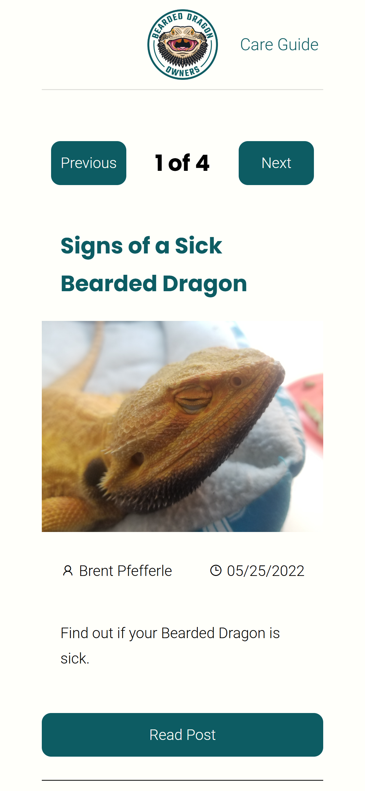

# Bearded Dragon Owners



This is a personal website created with Jekyll and is hosted on Github pages, it features a static blog 
with pagination and provides information regarding Bearded Dragon care for people that have 
pet Bearded Dragons. Overall, this website is responsive and well-designed using a combination 
of CSS grid, CSS flexbox, and CSS media queries. In addition, the site uses Facebook like and chat plugins.

&copy; Bearded Dragon Owners 2024, all rights reserved.

## Links

[Facebook](https://www.facebook.com/BeardedDragonOwners)

[Website](https://beardeddragonowners.com/)

## Manage Amazon recommendations

Confirm the U.S. tracking ID and the site's listing in Amazon Associates Central before publishing links. Choose the exact product variant, verify the destination, and copy the long text link from SiteStripe for the selected tracking ID.

Add an entry under `products` in [`_data/affiliate.yml`](_data/affiliate.yml). Replace the sample key, text, date, and blank link with your verified details. The include accepts HTTPS product links on `www.amazon.com` with a single `tag` parameter matching `tracking_id`.

```yaml
products:
  product-key:
    name: "Product name and variant"
    description: "What the product is."
    rationale: "Why it is useful in this care context."
    amazon_url: ""
    reviewed_on: "YYYY-MM-DD"
```

For a photo you have permission to publish, place the file in `assets/img/affiliate/` and add an `image` mapping to the product entry. Set `filename`, `alt`, `width`, `height`, and `rights`. Use the original pixel dimensions and describe the source and permission in `rights`. Omit `image` for a text-only card.

Insert the include after the relevant editorial paragraph. A single key displays one card. To display a group, list the keys in order, separated by commas. Place grouped sections under an existing level-two heading so the group and card headings follow the page hierarchy.

```liquid



```

The include adds the visible commission disclosure and sponsored link attributes. An empty selection or one with no usable entries produces no section. Update a shared entry to update all its placements, or remove a key from a placement to remove it from one page. Delete a discontinued product from the catalog to remove it everywhere. Review the exact variant and destination on each update and record the date in `reviewed_on`.

Run a local Jekyll build before publishing. Check the recommendation and disclosure on a narrow screen and verify the destination and tracking tag. Keep demo entries outside the repository's publishable source.

